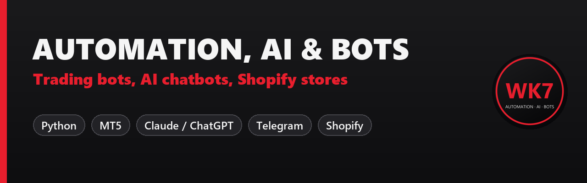

### Hi, I'm WK7: a developer who builds things that make or save you money

I build **trading bots for MetaTrader 5**, **AI chatbots with Claude and ChatGPT**, **Telegram and Discord bots**
and **Shopify stores**. Clean Python code, honest testing, fast replies.

## Projects

| Project | What it does |
|---|---|
| [**mt5-python-trading-bot**](https://github.com/Wkk7/mt5-python-trading-bot) | MT5 bot in Python: risk % sizing, SL/TP, daily loss limit, Telegram alerts, honest backtest with real costs |
| [**telegram-signal-copier-mt5**](https://github.com/Wkk7/telegram-signal-copier-mt5) | copies signals from your Telegram channel to your MT5 account, with a tested parser and multiple TPs |
| [**ai-support-chatbot-claude**](https://github.com/Wkk7/ai-support-chatbot-claude) | support chatbot that answers from your documents with Claude: web chat and Telegram, lead capture |

## Services

| | |
|---|---|
| **Trading bots** | your strategy as an MT5 Expert Advisor or Python bot, tested on demo |
| **Backtests** | honest results with spread, commission and out-of-sample checks |
| **AI chatbots and automations** | Claude / ChatGPT assistants trained on your documents |
| **Telegram and Discord bots** | alerts, reports, community tools, signal copiers |
| **Shopify** | store setup and redesign that converts |

## Tech

`Python` `pandas` `MetaTrader 5` `MQL5` `Claude API` `OpenAI API` `Flask` `Telegram Bot API`
`Java` `JavaScript` `HTML/CSS` `SQL` `Shopify` `Git`

## Work with me

**[Hire me on Fiverr](https://www.fiverr.com/wassimkamill)**: tell me your idea and I'll tell you honestly what is possible.
